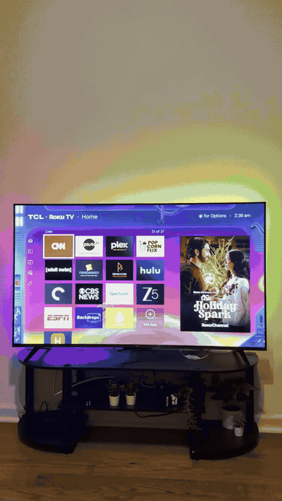

# HackerTube for Roku

Watch the videos from [HackerTube](https://hackertube.org/) on your Roku TV. Browse the Hacker News-curated collection by topic, search for something interesting, and play it with your remote.

This is an unofficial, open-source Roku app. No sign-in is needed to browse or watch. The current release includes 6,454 videos from HackerTube's October 31, 2026 catalog snapshot. Launch, playback, browsing, topic filtering, and sorting have been tested by the owner on a Roku TV.

## Install on your Roku TV

You need a Roku TV or Roku streaming device and a computer on the same local network.

1. **Download the app.** Open [the latest GitHub Release](https://github.com/piyushkhemka/hackertube-roku-app/releases/latest) and download **`build.zip`**. This is the only file you need to install. GitHub's **Source code** archives are for developers.
2. **Set up Roku Developer Mode.** On your Roku remote, press **Home** 3 times, **Up** 2 times, then **Right, Left, Right, Left, Right**.
3. **Enable the installer.** Follow the instructions on the TV, accept the agreement, and create a developer password. Your Roku will restart. Write down the **URL/IP address shown on the TV** (for example, `http://192.168.1.100`).


4. **Open that URL on your computer.** Sign in with username **`rokudev`** and the developer password you just set. Make sure the computer and Roku are on the same network.
5. **Sideload HackerTube.** In the **Development Application Installer**, choose **Upload**, select `build.zip`, and click **Install**.


HackerTube should open on your TV and appear on your Roku home screen. To update it, repeat steps 1, 4, and 5 with a newer ZIP.

Roku supports one sideloaded developer app at a time; installing this replaces any existing sideloaded app. Some YouTube videos may be unavailable or fail to play. Playback requires internet access and relies on YouTube and Playlet's support service.

## Browse and watch

- Use the top menu for **Search**, **Topics**, **Sort**, and **About**. Press **OK** to apply a highlighted choice; **Back** cancels a menu.
- Press **Down** to enter the video grid. Keep pressing Down to scroll and automatically load more videos. Press **OK** to play.
- Press **Back** from the grid, or **Up** from the first row, to return to the menu. Back during playback exits the video.
- Use the player's playback and seek controls to pause, resume, fast-forward, and rewind.
- **Top recommended** is the default ranking. **Recently recommended on HN** uses the latest recommendation year, not the video's upload date. **Title A–Z** sorts alphabetically. Sorting preserves the selected topic and search.

This version uses a bundled catalog snapshot and keyword search. It does not include accounts, personalized recommendations, saved lists, or automatic catalog updates.

[](https://github.com/piyushkhemka/hackertube-roku-app/raw/refs/heads/main/media/hackertube-demo.mp4)

[Download the full demo with sound (MP4)](https://github.com/piyushkhemka/hackertube-roku-app/media/hackertube-demo.mp4).

## Credits

[**HackerTube**](https://hackertube.org/about) credits [Andrej Karpathy](https://github.com/karpathy) with prompting its creation. It collects YouTube videos recommended across years of Hacker News discussions. This Roku app uses HackerTube's publicly released catalog, which draws on the [open-index/hacker-news](https://huggingface.co/datasets/open-index/hacker-news) archive. Thanks for making the catalog reusable.

[**Playlet**](https://github.com/iBicha/playlet), created by [iBicha](https://github.com/iBicha), provides the Roku YouTube playback foundation on which this app is built. The Playlet-derived source and upstream notices are included in [`vendor/playlet/`](vendor/playlet/). Credit to Playlet's contributors for making a Roku YouTube client available as open source.

This is an independent project, not an official app from HackerTube, Karpathy, Playlet, YouTube, or Roku. See [ATTRIBUTION.md](ATTRIBUTION.md) for additional credits.

## License

The distributed catalog app is licensed under **[GNU AGPL-3.0](LICENSE)**. The root license and package metadata identify the catalog app accordingly; upstream Playlet notices are preserved.

- **Catalog app and Playlet-derived code:** AGPL-3.0. Releases include the corresponding modified source and build scripts.
- **HackerTube catalog data:** [ODC-By 1.0](https://opendatacommons.org/licenses/by/1-0/), with attribution to HackerTube and the source archive.
- **Independent original diagnostic prototype:** retains its [MIT license](LICENSES/MIT.txt). It is separate from the distributed catalog app.

See [LICENSING.md](LICENSING.md) for exact scope and exceptions. These licenses do not grant rights to underlying YouTube videos or HackerTube branding.

## Build from source

You'll need **Node.js 22**, **npm**, **Python 3.10+**, and **Bash**. The build installs its locked npm dependencies when needed.

```bash
git clone https://github.com/piyushkhemka/hackertube-roku-app.git
cd hackertube-roku-app
bash tools/build_catalog_app.sh
```

Upload `dist/build.zip` using the steps above. The build also produces `dist/build-source.zip` and SHA-256 checksum files. The installer ZIP has `manifest` at its root and includes the playback library.

To reproduce a release, check out its tag before building. You can also extract GitHub's **Source code (zip)** archive for that release and run the same build command from its root.

The build checks compilation, XML, asset references, catalog integrity, and ZIP structure. Run Python tests with:

```bash
python3 -m unittest discover -s tests -v
```

See [build 4 notes](docs/CATALOG_BUILD_4.md) for the navigation fixes and test details. The independent diagnostic prototype remains in `roku/`; it is not the app ZIP linked above.
